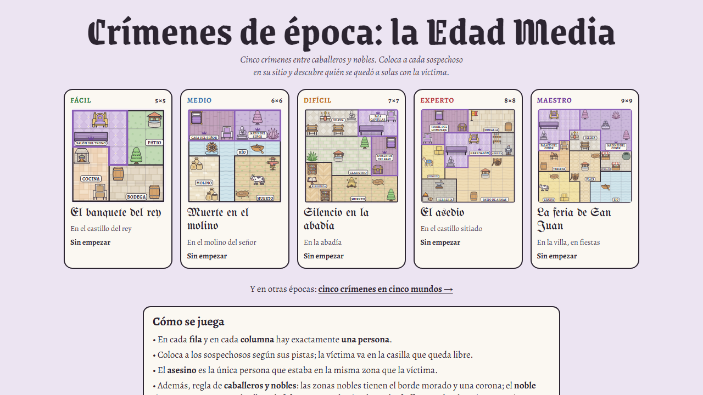

# Crímenes de época: la Edad Media

Cinco crímenes entre caballeros y nobles. Un sudoku de asesinatos: coloca a cada sospechoso en su sitio, uno por fila y
por columna, y descubre quién se quedó a solas con la víctima. Los casos van del fácil al maestro. Juego web autónomo en
un único `index.html`.

**Jugar:** https://spyder-cripto.github.io/crimenes-de-epoca-edad-media/ · Y en otras épocas:
[cinco crímenes en cinco mundos](https://spyder-cripto.github.io/crimenes-de-epoca/).

## Cómo se juega
- En cada **fila** y en cada **columna** hay exactamente **una persona**.
- Coloca a los sospechosos según sus pistas; la víctima va en la casilla que queda libre.
- El **asesino** es la única persona que estaba en la misma zona que la víctima.
- **Ninguna zona se quedó vacía.**
- No se puede estar en una casilla con un objeto, salvo los que se ocupan (sillas, bancos, caballos…).
- «Al lado de» es arriba, abajo, a la izquierda o a la derecha; «al este de», en cualquier columna a su derecha (no hace falta que sea la de al lado); «al norte de», en cualquier fila más arriba.
- **Caballeros y nobles:** las zonas nobles tienen el borde morado y una corona; el **noble** tiene que estar en una de
  ellas, el **plebeyo** no puede pisarlas y el **caballero** va donde quiera.
- **Colocar**, **notas** (las iniciales de quien podría estar en cada casilla) y **tachar**; deshacer, comprobar y pistas
  opcionales, que enseñan el siguiente paso de la deducción.

## Los casos
| Nivel | Caso | Lugar |
|---|---|---|
| Fácil · 5×5 | El banquete del rey | En el castillo del rey |
| Medio · 6×6 | Muerte en el molino | En el molino del señor |
| Difícil · 7×7 | Silencio en la abadía | En la abadía |
| Experto · 8×8 | El asedio | En el castillo sitiado |
| Maestro · 9×9 | La feria de San Juan | En la villa, en fiestas |

Cada caso tiene una sola solución, comprobada por ordenador (y por un segundo comprobador independiente). En todos hacen
falta la regla de caballeros y nobles y «ninguna zona vacía», y no sobra ninguna pista.

## Créditos
- Casos, arte y textos: **Spider** (Fali + Claude), 2026.
- Inspirado en los *Murdoku* de Manuel Garand.
